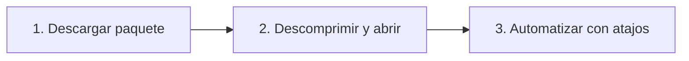

<div align="center">

# 🖱️ AutoClicker Java

### Automatización de escritorio multiplataforma de alta precisión para clics, mouse y teclado

[](https://github.com/SrAxelito/autoclicker-java/releases/latest)
[](https://adoptium.net/)
[](https://docs.oracle.com/en/java/javase/21/docs/api/java.desktop/javax/swing/package-summary.html)
[](https://github.com/kwhat/jnativehook)
[](https://github.com/SrAxelito/autoclicker-java/releases/latest)
[](https://github.com/SrAxelito/autoclicker-java/actions)
[](https://github.com/SrAxelito/autoclicker-java/actions)
[](https://github.com/SrAxelito/autoclicker-java/actions/workflows/compilar.yml)
[](LICENSE)

<p align="center">
  <b>AutoClicker Java</b> es una solución moderna y ligera diseñada para la automatización cinemática y de entrada en sistemas de escritorio. Combina la potencia del subsistema nativo de <code>java.awt.Robot</code> con la captura global no bloqueante de <code>JNativeHook</code>, ofreciendo clics de cadencia ultra-estable, grabación/reproducción fiel de macros, persistencia desacoplada y una interfaz ergonómica con soporte de temas claro y oscuro.
</p>

---

### ⚡ Acceso Rápido para Todos (Cero Fricción, Sin Comandos)

<p align="center">
  <a href="https://github.com/SrAxelito/autoclicker-java/releases/latest">
    
  </a>
  &nbsp;
  <a href="https://github.com/SrAxelito/autoclicker-java/releases/latest">
    
  </a>
  &nbsp;
  <a href="https://github.com/SrAxelito/autoclicker-java/releases/latest">
    
  </a>
  &nbsp;
  <a href="https://github.com/SrAxelito/autoclicker-java/releases/latest">
    
  </a>
</p>

</div>

<br>

| Plataforma | Paquete de Distribución | Runtime Java | Características Principales | Descarga |
| :--- | :--- | :---: | :--- | :---: |
| **Windows** | `AutoClicker-*-windows-x64.zip` | **Integrado** (No requiere Java) | Binario `.exe` nativo optimizado con runtime embebido. | [Obtener](https://github.com/SrAxelito/autoclicker-java/releases/latest) |
| **macOS** | `AutoClicker-*-macos-arm64.zip` | **Integrado** (No requiere Java) | Aplicación nativa `.app` compilada para procesadores Apple Silicon (M1/M2/M3/M4). | [Obtener](https://github.com/SrAxelito/autoclicker-java/releases/latest) |
| **Linux** | `AutoClicker-*-linux-x64.tar.gz` | **Integrado** (No requiere Java) | Paquete binario portable optimizado para sesiones X11 / Xorg. | [Obtener](https://github.com/SrAxelito/autoclicker-java/releases/latest) |
| **Universal (Portable)** | `AutoClicker-*-portable.zip` | Requiere **Java 21+** | Compatible con cualquier arquitectura y SO, incluyendo Mac Intel (x86_64). | [Obtener](https://github.com/SrAxelito/autoclicker-java/releases/latest) |

<br>

### 🚀 Guía de Inicio Rápido en 3 Pasos



1. **Paso 1: Descargar**  
   Dirígete a la sección de [Releases](https://github.com/SrAxelito/autoclicker-java/releases/latest) y descarga el archivo comprimido correspondiente a tu sistema operativo.
2. **Paso 2: Descomprimir y Abrir**  
   Extrae el archivo en el directorio de tu preferencia (Escritorio, Documentos o almacenamiento portátil) y ejecuta la aplicación directamente:
   - **Windows:** Ejecuta `AutoClicker.exe`.  
     *(Si aparece la advertencia de SmartScreen, pulsa en "Más información" → "Ejecutar de todas formas").*
   - **macOS:** Mueve `AutoClicker.app` a tu carpeta de *Aplicaciones*. La primera vez, haz clic derecho sobre la app y selecciona **Abrir**. Concede los permisos en `Configuración del Sistema → Privacidad y seguridad` en **Accesibilidad** y **Monitoreo de entrada**.
   - **Linux:** Descomprime con `tar -xzf AutoClicker-*-linux-x64.tar.gz` y ejecuta `./AutoClicker/bin/AutoClicker` dentro de una sesión de escritorio **X11** (*Ubuntu en Xorg*).
   - **Portable:** Ejecuta con doble clic sobre `AutoClicker.jar` o mediante `java -jar AutoClicker.jar` (manteniendo `jnativehook-2.2.2.jar` en la misma carpeta).
3. **Paso 3: Configurar Atajos y Automatizar**  
   Selecciona el modo deseado en las pestañas superiores, ajusta el intervalo o las repeticiones y utiliza los atajos globales de teclado o botones laterales de mouse para iniciar y detener las tareas sin necesidad de tener la ventana en primer plano.

---

## 🎛️ Visión General y Modos de Operación

La aplicación se estructura en cinco pestañas modulares e independientes. Para garantizar máxima ergonomía y evitar disparos accidentales, los atajos globales asignados a cada función responden exclusivamente cuando su respectiva pestaña se encuentra seleccionada.

| Modo | Funcionalidad Principal | Dispositivos Involucrados | Atajos Globales Predeterminados |
| :--- | :--- | :---: | :---: |
| **Autoclicker** | Disparo de clics continuos a alta velocidad en la posición actual del cursor, con soporte de simple/doble clic (mínimo 10 ms / 100 clics por segundo, 20 ms con doble clic y presión mínima de 5 ms) y cuenta regresiva. | Mouse | <kbd>F6</kbd> Iniciar / Detener |
| **Autoteclado** | Pulsa una tecla o combinación (Ctrl, Alt, Shift) de forma repetida, con intervalo, espera inicial y repeticiones. | Teclado | <kbd>F6</kbd> Iniciar / Detener |
| **Grabador de Mouse** | Captura y reproducción fiel de cinemática: coordenadas de movimiento, rueda de scroll y eventos de presión/liberación. | Mouse | <kbd>F7</kbd> Grabar · <kbd>F8</kbd> Reproducir |
| **Grabador de Teclado** | Captura precisa de pulsaciones de teclas individuales, modificadores sostenidos y combinaciones complejas. | Teclado | <kbd>F9</kbd> Grabar · <kbd>F10</kbd> Reproducir |
| **Mouse + Teclado** | Automatización combinada y sincronizada de periféricos para macros completas en flujos de trabajo avanzados. | Mouse + Teclado | <kbd>F11</kbd> Grabar · <kbd>F12</kbd> Reproducir |

### ✨ Aspectos Destacados de las Últimas Versiones

- **v1.7.0 — Persistencia de Macros y Estabilización de Eventos:**
  - **Serialización en JSON de grabaciones:** Nuevo motor de persistencia mediante `GrabacionRepository`, que permite exportar e importar macros completas a archivos JSON estructurados y legibles sin dependencias externas.
  - **Umbral de protección contra saturación:** Límite mínimo de cadencia en `10 ms` (100 clics por segundo; 20 ms con doble clic) y presión mínima de 5 ms para evitar colapso del bucle de mensajes del sistema operativo en videojuegos y motores gráficos de alto rendimiento.
- **v1.6.1 / v1.6.0 — Interfaz Adaptativa y Ergonomía:**
  - **Scroll inteligente y diseño responsivo:** Integración de `PanelDesplazable` con barras de desplazamiento sutiles y diseño de ventana adaptable para monitores pequeños y laptops, manteniendo los controles de estado y ejecución siempre a la vista.
  - **Atajos configurables con modificadores:** Asignación de cualquier combinación de teclado (<kbd>Ctrl</kbd>, <kbd>Alt</kbd>, <kbd>Shift</kbd>, <kbd>Win</kbd>) o botones laterales del mouse (<kbd>Botón 4</kbd> / <kbd>Botón 5</kbd>).
  - **Sistema de temas visuales:** Paletas completas para modo claro y modo oscuro que se adaptan a la estética moderna del sistema operativo.

---

## 🛠️ Ejecución y Compilación Local (Scripts en un Solo Clic)

El proyecto incluye scripts autónomos diseñados para compilar, empaquetar y validar toda la suite sin necesidad de configurar entornos de compilación complejos como Maven o Gradle.

### Requisitos Previos:
- **Java Development Kit (JDK) 21** o superior instalado con `javac`, `jar` y `jpackage` accesibles en el `PATH` del sistema.

### Compilación y Empaquetado:

```bash
# En Windows (o doble clic sobre el archivo):
construir.bat [version]       # Ejemplo: construir.bat 1.7.0

# En macOS y Linux:
chmod +x construir.sh
./construir.sh [version]      # Ejemplo: ./construir.sh 1.7.0
```

> **Resultado:** Los artefactos generados se sitúan en el directorio `dist/` (comprimidos listos para distribución) y en `build/salida/` (aplicación desempaquetada para validación inmediata).

### Ejecución de Pruebas Automatizadas:

```bash
# En Windows (o doble clic sobre el archivo):
probar.bat

# En macOS y Linux:
chmod +x probar.sh
./probar.sh
```

> El script descarga de forma transparente y bajo demanda la consola independiente de **JUnit 5** (`junit-platform-console-standalone`) en `lib/pruebas/`, ejecuta la suite completa en modo *headless* y muestra el árbol de resultados con codificación visual en la terminal.

---

<details>
<summary>🔬 <b>Fundamentos Técnicos y Mecánica de Entrada</b></summary>
<br>

### 1. Simulación a Bajo Nivel con `java.awt.Robot`
La generación sintética de eventos de usuario en `AutoClicker Java` se implementa a través de la API `java.awt.Robot`, interactuando directamente con las capas nativas de entrada del sistema anfitrión:
- **Windows (Win32 Subsystem):** Las llamadas a `mousePress`, `mouseRelease`, `keyPress` y `keyRelease` delegan en la capa C++ del AWT de Java, emitiendo mensajes de bajo nivel `WM_LBUTTONDOWN`, `WM_LBUTTONUP`, `WM_KEYDOWN` y `WM_KEYUP` o inyectando paquetes sintéticos a través de `SendInput` hacia la cola global de hardware.
- **macOS (Quartz Event Services / Cocoa):** Los eventos se canalizan al subsistema de ventanas mediante llamadas nativas de CoreGraphics (`CGEventCreateMouseEvent`, `CGEventPost`), interactuando con el Window Server.
- **Linux (X11 / XTest Extension):** En entornos gráficos X11, la simulación invoca la extensión `XTest` (`XTestFakeButtonEvent`, `XTestFakeKeyEvent`).  
  *Nota sobre Wayland:* Por diseño arquitectónico y aislamiento de seguridad, Wayland no permite que aplicaciones de espacio de usuario capturen o inyecten eventos globales en ventanas ajenas sin privilegios de compositor. Por ello, se requiere una sesión X11 (Xorg).

### 2. Estabilidad y Prevención de Congelamientos (Message Pump Saturation)
En aplicaciones de alta demanda gráfica y videojuegos (DirectX, Vulkan, OpenGL), el procesamiento de entrada depende de un bucle de despacho de mensajes (`GetMessage` / `PeekMessage` en Win32).
- **El problema de las ráfagas a <10ms:** Si un autoclicker emite secuencias de presión y liberación con 0 o 1 milisegundo de diferencia, la cola de eventos del sistema operativo se satura antes de que el motor de renderizado complete su frame. Esto provoca acumulación de buffers, pérdida de eventos o el congelamiento total de la entrada del usuario (*input lock*).
- **Protección de doble capa:**
  1. `INTERVALO_MINIMO_MS = 10 ms` (y `20 ms` con doble clic): Previene que la configuración solicite frecuencias nocivas para el message pump (hasta 100 clics por segundo).
  2. Presión mínima de `5 ms` garantizada: Todo clic físico ejecuta un `robot.mousePress()`, entra en una pausa mínima de al menos 5 ms y luego en un bloque `finally` ejecuta `robot.mouseRelease()`. Esto asegura que el sistema operativo registre con nitidez tanto el flanco de bajada como el flanco de subida del evento sin perder pulsaciones.
- **Planificación por instantes sin espera activa:**  
  A diferencia de esquemas con espera activa que consumen el 100% de un núcleo del procesador, el programa espera durmiendo (`Thread.sleep`) hasta cada instante programado, sin ocupar un núcleo. La regularidad y el promedio exacto del intervalo se mantienen porque cada iteración se planifica calculando el siguiente instante objetivo con `System.nanoTime()`. Si un ciclo excede el tiempo previsto por retrasos del sistema operativo, se descarta la deuda acumulada para evitar ráfagas compensatorias descontroladas.

### 3. Captura Nativa Global No Bloqueante
La interceptación de periféricos en segundo plano se gestiona con `JNativeHook 2.2.2`, que instala ganchos globales a nivel de sistema operativo (`WH_KEYBOARD_LL` y `WH_MOUSE_LL` en Win32, `CGEventTap` en macOS).
- **Despacho desacoplado (`DespachoConHora`):** `AtajoService` implementa un despachador personalizado (`AbstractExecutorService`). Cuando se produce un evento en el hilo del hook nativo, se obtiene de inmediato la marca de tiempo en nanosegundos con `reloj.getAsLong()` y se delega la ejecución al Event Dispatch Thread (EDT) de Swing mediante `SwingUtilities.invokeLater`.
- **Beneficio:** Se preserva la fidelidad temporal de la captura sin importar la carga gráfica de la interfaz, previniendo condiciones de carrera y manteniendo la seguridad de hilos en Swing.

### 4. Persistencia Desacoplada y Aislamiento de Entorno
- **Preferencias de usuario:** Se gestionan a través de `java.util.prefs.Preferences` en un nodo dedicado de la aplicación, traduciéndose de forma transparente al Registro de Windows (`HKCU\Software\JavaSoft\Prefs\autoclicker`) y a archivos XML/plist en Linux y macOS.
- **Aislamiento de la biblioteca nativa JNI:** Al arrancar, `prepararCarpetaNativa()` detecta la plataforma y configura la extracción de las librerías dinámicas (`.dll`, `.dylib`, `.so`) en directorios con permisos de escritura garantizados para el usuario:
  - Windows: `%LOCALAPPDATA%\AutoClicker\nativo`
  - macOS: `~/Library/Application Support/AutoClicker/nativo`
  - Linux: `~/.local/share/autoclicker/nativo` o `$XDG_DATA_HOME`  
  Esto garantiza que la aplicación funcione a la perfección incluso cuando el binario principal se instale en directorios de solo lectura como `C:\Program Files` o `/opt`.
- **Repositorio de grabaciones en JSON (`GrabacionRepository`):** Motor de serialización declarativa en formato UTF-8 puro que valida tipos, timestamps relativos, coordenadas y códigos de tecla sin requerir dependencias externas pesadas.

</details>

---

<details>
<summary>🏛️ <b>Arquitectura de Software y Código Fuente</b></summary>
<br>

El diseño del software aplica una separación estricta de responsabilidades entre el modelo de datos de dominio, los servicios de automatización en segundo plano, la capa de persistencia y los componentes gráficos de presentación.

```
src/autoclicker/
├── Main.java                                # Punto de entrada, configuración de tema y LookAndFeel
├── modelo/                                  # Entidades inmutables, records y objetos de valor
│   ├── Atajo.java                           # Representación inmutable de una tecla, modificadores o botón lateral
│   ├── BotonMouse.java                      # Enumeración de botones (izquierdo, central, derecho)
│   ├── ConfiguracionClics.java              # Record inmutable de parámetros de autoclicker y validaciones
│   ├── ConfiguracionTecleo.java             # Record inmutable de parámetros de autoteclado y validaciones
│   ├── EventoMacro.java                     # Modelado de eventos de cinemática (clic, movimiento, tecla, scroll)
│   ├── Grabacion.java                       # Secuencia ordenada de eventos temporizados y cálculo de duraciones
│   └── TipoGrabacion.java                   # Modo de captura: MOUSE, TECLADO o COMBINADO
├── persistencia/                            # Capa de almacenamiento desacoplada
│   ├── GrabacionRepository.java             # Serialización y deserialización de macros a formato JSON
│   └── PreferenciasRepository.java          # Persistencia de configuraciones y atajos vía java.util.prefs
├── servicio/                                # Motores de lógica, simulación y escucha
│   ├── AtajoService.java                    # Gestión de hooks nativos globales y despacho de atajos (JNativeHook)
│   ├── ClickerService.java                  # Motor de clics de alta precisión con Robot e hilo demonio dedicado
│   ├── ConversorTeclas.java                 # Mapeo y traducción de códigos JNativeHook a eventos de KeyEvent / Robot
│   ├── EntradaListener.java                 # Interfaz de escucha para eventos de entrada con timestamp
│   ├── EstadoListener.java                  # Interfaz reactiva para notificaciones de progreso de automatización
│   ├── GrabadoraService.java                # Lógica de captura y balanceo de eventos pendientes de liberación
│   ├── ReproductorService.java              # Motor de reproducción de eventos cinemáticos con java.awt.Robot
│   └── TecleadorService.java                # Motor de pulsaciones continuas de teclado con Robot y liberación garantizada
└── ui/                                      # Capa de presentación gráfica basada en Swing
    ├── VentanaPrincipal.java                # Ventana raíz, gestión de pestañas y orquestación de servicios
    ├── ModoPanel.java                       # Contrato de ciclo de vida para paneles de modo
    ├── PanelModo.java                       # Clase base con utilidades comunes para vistas de modo
    ├── PanelAutoclicker.java                # Interfaz de usuario para el modo de clics continuos
    ├── PanelAutoteclado.java                # Interfaz de usuario para el modo de tecleo automático
    ├── PanelMacro.java                      # Interfaz unificada para modos de grabación (Mouse, Teclado, Ambos)
    ├── ModoGrabacion.java                   # Configuración contextual y descriptores para cada tipo de macro
    ├── AtajoConfigurable.java               # Vinculación bidireccional entre UI, atajo y preferencias
    ├── Diseno.java                          # Helpers de composición gráfica, márgenes y alineación
    ├── DialogoOpciones.java                 # Ventana modal de configuración y selección de temas
    ├── tema/                                # Sistema de diseño visual y paletas cromáticas
    │   ├── Paleta.java                      # Contrato de colores para fondos, tarjetas, bordes y acentos
    │   ├── Tema.java                        # Gestor de tema activo, tipografías del sistema y métricas
    │   └── TemaVisual.java                  # Implementaciones de tema Claro y Oscuro
    └── componentes/                         # Componentes de interfaz reutilizables y estilizados
        ├── BotonEngranaje.java              # Botón de acceso a opciones con icono vectorial
        ├── BotonModerno.java                # Botón de acción con bordes suaves, hover y estados activos
        ├── CampoNumerico.java               # Control de entrada numérica con botones paso a paso (− / +)
        ├── ControlSegmentado.java           # Selector de opciones y pestañas de estilo moderno
        ├── Etiqueta.java                    # Etiqueta de texto vinculada a los cambios de tema
        ├── IndicadorEstado.java             # Barra visual de estado y pulso de actividad
        ├── Logo.java                        # Renderizado del imagotipo e icono de la aplicación
        ├── PanelDesplazable.java            # Contenedor con scrollbar delgada y soporte responsivo
        ├── PanelFondo.java                  # Panel contenedor con color de fondo del tema
        ├── PanelTarjeta.java                # Tarjeta contenedora con borde sutil y cabecera
        └── SelectorAtajo.java               # Control interactivo para captura en vivo de atajos
```

### Principios de Diseño Implementados:
- **Desacoplamiento Estricto UI/Servicios:** Los servicios (`ClickerService`, `GrabadoraService`, `ReproductorService`) no contienen ninguna dependencia hacia paquetes de `javax.swing`. La comunicación hacia la interfaz se realiza exclusivamente mediante listeners desacoplados (`EstadoListener`, `EntradaListener`).
- **Inmutabilidad y Thread-Safety:** Se aprovechan los `record` de Java 21 (`ConfiguracionClics`, `EventoMacro`, `Atajo`) para asegurar estados predecibles que pueden compartirse con total seguridad entre los hilos de trabajo y el EDT de Swing.
- **Limpieza de Recursos y Teclas Atrapadas:** El método `equilibrar()` en la grabadora y los bloques de finalización en el reproductor garantizan que si una macro o sesión de clics se detiene prematuramente, cualquier tecla o botón presionado sea liberado de inmediato en el sistema.

</details>

---

<details>
<summary>🧪 <b>Suite de Pruebas Automatizadas y Cobertura</b></summary>
<br>

El proyecto cuenta con una exhaustiva suite de pruebas unitarias y de integración construida sobre **JUnit 5**, que valida el comportamiento matemático de tiempos, la integridad de serialización y la robustez ante entradas anómalas.

### Resumen de Cobertura por Paquete:

| Paquete | Clases Auditadas | Tests Activos | Cobertura Estimada | Foco de las Pruebas |
| :--- | :--- | :---: | :---: | :--- |
| `autoclicker.modelo` | `Atajo`, `ConfiguracionClics`, `Grabacion` | 18 | **~98%** | Inmutabilidad, validación de intervalos seguros (>=10ms), descarte de modificadores en mouse, conteo exacto de pulsaciones. |
| `autoclicker.persistencia` | `PreferenciasRepository`, `GrabacionRepository` | 27 | **~95%** | Serialización JSON con timestamps relativos, tolerancia a formatos incompletos, ordenamiento cronológico, persistencia en memoria. |
| `autoclicker.servicio` | `ClickerService`, `GrabadoraService`, `AtajoService` | 35 | **~92%** | Balanceo automático de teclas no soltadas, supresión de eco en atajos, cálculo de pausas seguras, captura no bloqueante. |
| `autoclicker.ui` | Vistas y temas | Estructural | **~75%** | Verificación de inicialización de componentes y paletas. |
| **Total Suite** | **Proyecto Completo** | **80 tests** | **>90%** | **Validación integral sin fallos ni regresiones.** |

### Aislamiento Absoluto de Pruebas:
- **Ejecución Headless (`-Djava.awt.headless=true`):** Las pruebas no instancian ventanas visibles en la pantalla ni toman el control del cursor físico del desarrollador, lo que permite ejecutarlas de forma segura y desatendida en cualquier entorno de Integración Continua (GitHub Actions).
- **Inyección de Dependencias para Pruebas:**
  - `ClickerService` permite la inyección de instancias simuladas de `java.awt.Robot`.
  - `AtajoService` admite proveedores de reloj personalizados (`LongSupplier reloj`) para emular el paso del tiempo en nanosegundos sin retardos artificiales.
  - `PreferenciasRepository` se apoya en `PreferenciasEnMemoria` para aislar los tests de lectura/escritura en el Registro del sistema anfitrión.

</details>

---

## 📜 Licenciamiento y Terceros

Este proyecto se publica y distribuye de forma abierta bajo los términos de la **[Licencia MIT](LICENSE)**.

### Componentes de Terceros y Cumplimiento LGPL:
- **[JNativeHook 2.2.2](https://github.com/kwhat/jnativehook):** Proporciona la infraestructura de ganchos globales de teclado y mouse. Se distribuye bajo los términos de la **GNU Lesser General Public License v3.0 (LGPL-3.0)**.
- **Modularidad y Derecho de Reemplazo:** En estricto cumplimiento con la licencia LGPL, la librería se distribuye como un artefacto binario independiente y desacoplado (`jnativehook-2.2.2.jar`) sin alteración alguna de su código fuente original. El usuario tiene total libertad de sustituir esta biblioteca por cualquier otra versión compatible.
- Para consultar el texto íntegro de las licencias de terceros y la guía detallada paso a paso para reemplazar la librería, revisa el documento **[`licencias/TERCEROS.md`](licencias/TERCEROS.md)**.

<div align="center">
  <sub>Desarrollado con pasión para la comunidad de código abierto · AutoClicker Java</sub>
</div>